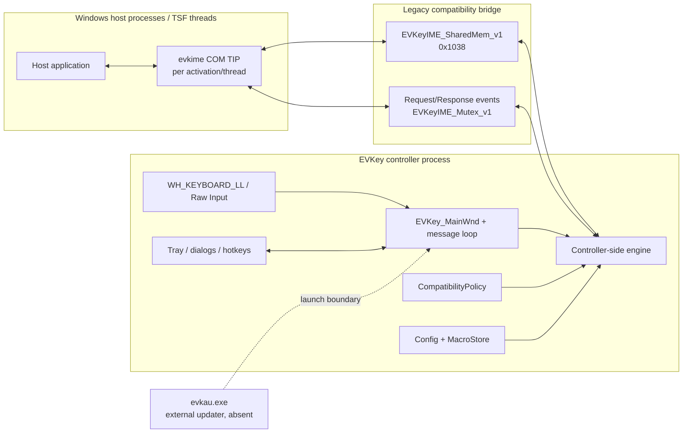
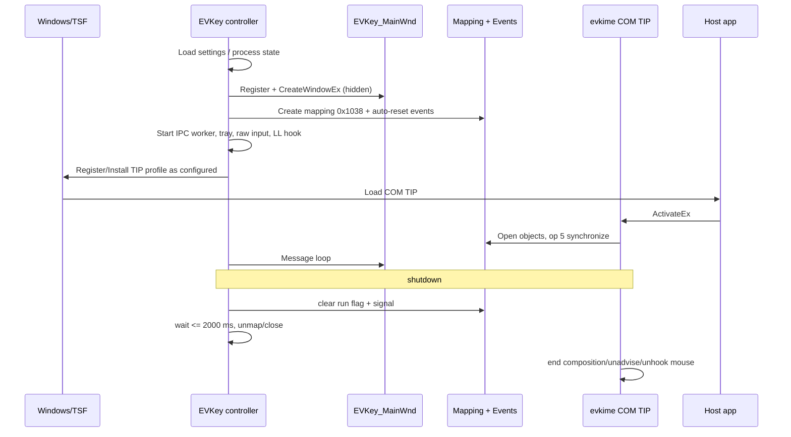
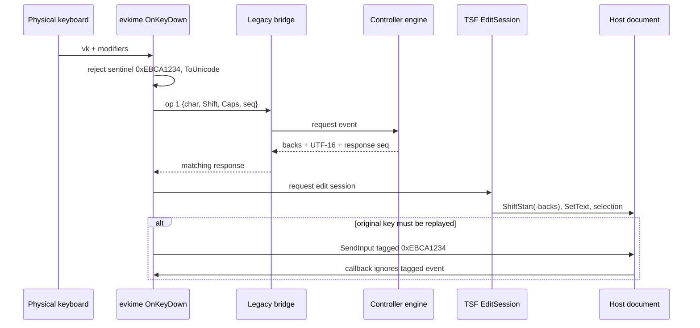
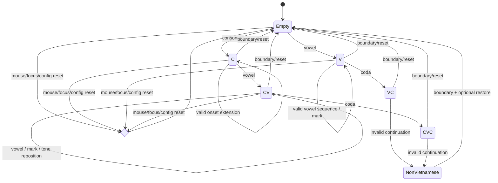

# Hồ sơ reconstruction EVKey 6.0.5.0

## 1. Tóm tắt điều hành

**Quan sát.** Gói tĩnh gồm ba controller GUI cho x86/x64/ARM64 và bốn đường dẫn DLL; hai bản `evkime32.dll` trùng byte. Ba EXE mang version `6.0.5.0`; DLL không có VERSION resource. Tất cả có certificate table nhưng phân tích không xác minh Authenticode image digest, và certificate leaf là self-signed nên không được hiểu là integrity/trust đã xác nhận ([`research/pe_inventory.md:11-19`](research/pe_inventory.md#L11-L19), [`research/pe_inventory.md:23-31`](research/pe_inventory.md#L23-L31), [`research/pe_inventory.md:273-285`](research/pe_inventory.md#L273-L285)).

**Quan sát.** Kiến trúc x64 là controller `EVKey64.exe` có hidden window `EVKey_MainWnd`, low-level keyboard hook, và các surface tray/config/macro/compatibility; DLL `evkime*.dll` là COM TSF Text Input Processor nạp trong host app. DLL không export engine/hook kiểu UniKey cũ; nó gửi character/backspace/reset qua named shared memory/events sang phía đối diện (controller) và nhận lại `backspaces + UTF-16 replacement`, rồi áp bằng TSF edit session ([`research/evkey64_exe.md:47-63`](research/evkey64_exe.md#L47-L63), địa chỉ `0x140034f90`, `0x140033450`; [`research/evkime_dlls.md:22-33`](research/evkime_dlls.md#L22-L33), [`research/evkime_dlls.md:145-168`](research/evkime_dlls.md#L145-L168), địa chỉ x64 `0x180003c20`, `0x180002f00`).

**Ranh giới quan sát / suy luận của câu trên.** Phần **quan sát** chỉ là: DLL gửi request và *phía đối diện tồn tại* (`the server/controller implementing the other side is outside these DLLs`, [`research/evkime_dlls.md:130-132`](research/evkime_dlls.md#L130-L132); các transform controller-side "are not directly present in the analyzed DLL code", [`research/evkime_dlls.md:269`](research/evkime_dlls.md#L269)). **Vị trí engine** tiếng Việt nằm phía controller là **suy luận**, không quan sát được: không có dòng nào trong bốn báo cáo nguồn quan sát engine bên trong `EVKey64.exe`.

**Suy luận có giới hạn.** Engine tiếng Việt nằm phía controller sau cầu IPC, nhưng nội bộ thuật toán EVKey chưa được decompile/chứng minh trong dossier này. `x-unikey/src/ukengine` là mô hình clean-room hợp lý cho semantic events, word state, tone, undo, backspace và restore, không phải bằng chứng EVKey dùng hoặc fork engine đó ([`research/unikey_baseline.md:51-58`](research/unikey_baseline.md#L51-L58), [`research/evkime_dlls.md:241-269`](research/evkime_dlls.md#L241-L269)).

**Khuyến nghị.** Rewrite nên giữ compatibility shell (TSF COM identity, named IPC adapter khi cần, transaction semantics, app policy) nhưng xây engine thuần, typed, versioned và testable; không sao chép global shared struct, single request slot, fixed debug log, UI coupling hay pseudocode.

## 2. Phạm vi, phương pháp và nhãn

Phân tích chỉ tĩnh; không chạy EXE/DLL, không Wine và không dynamic tracing. Báo cáo PE ghi rõ bảy file và giới hạn tool/signature ([`research/pe_inventory.md:3-9`](research/pe_inventory.md#L3-L9)).

- **Quan sát**: trực tiếp từ metadata/resource/import/string/disassembly/decompilation.
- **Suy luận**: kiến trúc/hành vi có nhiều dấu vết nhưng chưa quan sát runtime.
- **Baseline UniKey**: claim từ source tại commit `e3b8f3b53bdaa700945a62e99129df625509cd38`; luôn cite `file:line` qua báo cáo baseline.
- **Đề xuất**: yêu cầu rewrite, không phải hành vi binary.
- **Chưa rõ**: bằng chứng hiện tại không đủ.

Manifest máy đọc: [`evidence/artifact_manifest.json`](evidence/artifact_manifest.json).

## 3. Danh tính artifact và ranh giới tin cậy

| Artifact | Kiến trúc | Bytes | SHA-256 |
|---|---|---:|---|
| `arm64/EVKeyArm64.exe` | ARM64 | 819056 | `7c2aa18379e673954cd04cdd2e6cc3f4c8c5f531a80666b20c20ed90772b4ba8` |
| `arm64/evkimearm64.dll` | ARM64 | 214896 | `5f288a34a1e44fe8ea240b76e61c77d068a80c508a05e85cbfcf289652e693f9` |
| `x64/EVKey64.exe` | x64 | 810352 | `5490731bb563cd22d36f3816c4eef9ed9c3b487cdc6023330002a59858e2f5ad` |
| `x64/evkime32.dll` | x86 | 157040 | `91b978ab3c816f78125afae8d4fe2390d2fa1ce3d696d2df223cb6f6b193d53d` |
| `x64/evkime64.dll` | x64 | 187248 | `1d53028833d6f44bb1dc47baf2ac7c5cea92aa9194a44d841fb26fcf25b9a65f` |
| `x86/EVKey32.exe` | x86 | 708464 | `56e06c73aa35674de12f9d4a4dc2485717b57ddc332f8c878e7019c529923c8b` |
| `x86/evkime32.dll` | x86 | 157040 | `91b978ab3c816f78125afae8d4fe2390d2fa1ce3d696d2df223cb6f6b193d53d` |

Các giá trị trên lấy từ inventory ([`research/pe_inventory.md:21-31`](research/pe_inventory.md#L21-L31)); quan hệ duplicate được xác nhận tại [`research/pe_inventory.md:287-292`](research/pe_inventory.md#L287-L292). ZIP gốc có SHA-256 `59ac1ceeb7fce4407f5565a9ecf885210b450a3b789e035f06d07728e26e78bc`, size `1504714`, được ghi trong manifest.

Các PE bật ASLR/DEP và có relocations, nhưng **CFG không được bật ở bất kỳ file nào** (không file nào set characteristic `GUARD_CF`); chỉ **cookie** (6/7 file, thiếu `x64/evkime64.dll`) và **`GuardFlags` của bản x86** (`CF_INSTRUMENTED`) là không đồng đều; đây là inventory hardening, không phải chứng minh an toàn runtime ([`research/pe_inventory.md:16`](research/pe_inventory.md#L16), [`research/pe_inventory.md:55-67`](research/pe_inventory.md#L55-L67)).

## 4. Kiến trúc artifact

**Quan sát.** EXE cài `WH_KEYBOARD_LL=13` với callback trong chính EXE tại `0x140031d70`, không dùng `RegisterHotKey`; DLL TIP cài `WH_MOUSE` theo current thread chỉ để reset/end composition khi click ([`research/evkey64_exe.md:133-148`](research/evkey64_exe.md#L133-L148), `0x1400340b0`; [`research/evkime_dlls.md:52-79`](research/evkime_dlls.md#L52-L79), `0x180002460`, `0x180001bf0`).

**Quan sát âm.** EXE không import remote-injection primitives; `LoadLibraryW` là local và keyboard callback nằm trong EXE. Thiết kế TIP là COM/TSF + IPC, không classic process injection ([`research/evkey64_exe.md:188-194`](research/evkey64_exe.md#L188-L194)).

## 5. Bản đồ capability nghiệp vụ

| Capability | Thành phần | Trạng thái bằng chứng |
|---|---|---|
| Bật/tắt VN, hotkeys, tray | EXE controller/hook | Quan sát UI/resources/hook ([`research/evkey64_exe.md:118-145`](research/evkey64_exe.md#L118-L145), `0x140031d70`, `0x140016ec0`) |
| Telex/VNI/VIQR/user map | Controller engine/UI | UI/input-method surfaces quan sát; exact EVKey transform chưa chứng minh ([`research/evkey64_exe.md:32-40`](research/evkey64_exe.md#L32-L40)) |
| Character/backspace transform | DLL ↔ controller IPC | Quan sát op 1/2 và response contract ([`research/evkime_dlls.md:102-130`](research/evkime_dlls.md#L102-L130), `0x180005550`, `0x180003c20`) |
| TSF text replacement/composition | DLL TIP | Quan sát ([`research/evkime_dlls.md:145-168`](research/evkime_dlls.md#L145-L168), `0x180002f00`) |
| Macro | EXE config + engine | UI/file `evkmacro.txt` quan sát; exact expansion là Unknown ([`research/evkey64_exe.md:32-40`](research/evkey64_exe.md#L32-L40), [`research/evkey64_exe.md:73-87`](research/evkey64_exe.md#L73-L87)) |
| Clipboard conversion/fallback | EXE | Quan sát controller/Win32 APIs; fallback role suy luận ([`research/evkey64_exe.md:200-213`](research/evkey64_exe.md#L200-L213), `0x14002b4e0`) |
| App special cases/cache | EXE + TIP | Danh sách/store quan sát, exact action phần lớn Unknown ([`research/evkey64_exe.md:215-240`](research/evkey64_exe.md#L215-L240); [`research/evkime_dlls.md:189-217`](research/evkime_dlls.md#L189-L217)) |
| Startup/elevation | EXE | Shortcut/task scheduler quan sát ([`research/evkey64_exe.md:97-116`](research/evkey64_exe.md#L97-L116), `0x140036850`, `0x140036990`) |
| Update | EXE → `evkau.exe` | Launcher boundary quan sát; network/protocol Unknown ([`research/evkey64_exe.md:150-170`](research/evkey64_exe.md#L150-L170), `0x140017480`) |

## 6. Startup và shutdown

**Quan sát.** App main `0x140034f90` đăng ký/tạo hidden `EVKey_MainWnd`, tạo event/worker, shell hook, tray, IME, macro path, raw input và message loop; teardown unload helper/IPC ([`research/evkey64_exe.md:47-63`](research/evkey64_exe.md#L47-L63)). IPC setup `0x140035850` tạo mapping `0x1038`, request/response auto-reset events và worker; cleanup `0x1400357a0` dừng, signal, chờ tối đa 2.000 ms, unmap/close ([`research/evkey64_exe.md:172-186`](research/evkey64_exe.md#L172-L186)). Controller cũng là phía đăng ký COM server và cài TIP profile (`regsvr32` `/s`/`/u`/`runas`, `input.dll` + `InstallLayoutOrTip`); chi tiết quan sát tại §14.1 ([`research/evkey64_exe.md:176-186`](research/evkey64_exe.md#L176-L186)).

**Quan sát.** TIP activation thử connect, advise sinks và cài mouse hook current thread; deactivation unhook và có thể post `0x403` tới `EVKey_MainWnd` ([`research/evkime_dlls.md:52-79`](research/evkime_dlls.md#L52-L79), x64 `0x180002460`, `0x180002780`). Exact single-instance arbitration còn Unknown; mutex EXE quan sát là unnamed ([`research/evkey64_exe.md:242-256`](research/evkey64_exe.md#L242-L256), `0x140035630`).

## 7. Luồng gõ tiếng Việt và transaction

**Quan sát.** Key handler lọc self-injected sentinel, modifiers, dùng `ToUnicode`, gửi op 1 và nhận số backspace + UTF-16. Edit session lùi `ITfRange`, kiểm tra context trên guarded paths, `SetText`, cập nhật selection/composition; replay vật lý dùng `SendInput` với `0xEBCA1234` ([`research/evkime_dlls.md:134-168`](research/evkime_dlls.md#L134-L168), x64 `0x180002cf0`, `0x180003c20`, `0x180002f00`, `0x180002a70`).

**Chưa rõ.** Vì engine server không được phục hồi trong report, không được khẳng định exact EVKey placement cho Telex/VNI/VIQR, `qu/gi`, modern tone hay invalid-word restore. Baseline UniKey cho mapping semantic (`x-unikey/src/ukengine/inputproc.cpp:100-162`) và contract `(backs, output)` (`x-unikey/src/ukengine/ukengine.cpp:1734-1808`) ([`research/unikey_baseline.md:234-268`](research/unikey_baseline.md#L234-L268)).

## 8. Engine state model đề xuất

Đây là **đề xuất dựa baseline**, không phải cấu trúc EVKey binary. UniKey `WordInfo` giữ form `nonVn/empty/c/v/cv/vc/cvc`, offsets, sequence ID, caps/tone/symbol/raw key (`x-unikey/src/ukengine/ukengine.h:127-145`) và chuyển trạng thái tại `ukengine.cpp:1347-1684` ([`research/unikey_baseline.md:246-281`](research/unikey_baseline.md#L246-L281)).

## 9. Backspace, undo và reset

**Quan sát.** TIP có history local bounded, decompilation cho thấy tối đa 32 entries, stride biểu kiến `0x208`; Backspace có thể pop snapshot hoặc gửi op 2 để nhận delete/replacement. Mouse click, context/thread changes, modifier/key không tương thích, stale bridge và separators có thể end/reset composition ([`research/evkime_dlls.md:155-162`](research/evkime_dlls.md#L155-L162), x64 `0x180003c20`). Con số/stride là decompiler-derived nên không nên biến thành public engine ABI.

**Baseline UniKey.** Repeated tone bỏ dấu và phát literal action key (`unikey/keyhook/vietkey.cpp:745-768`); repeated roof/hook/breve hoàn nguyên (`vietkey.cpp:447-634`) ([`research/unikey_baseline.md:206-219`](research/unikey_baseline.md#L206-L219)). `UkEngine` giữ raw history, xử lý semantic Backspace (`x-unikey/src/ukengine/ukengine.cpp:1921-1977`) và chỉ auto-restore khi có conversion/mark phù hợp (`ukengine.cpp:2183-2233,2270-2360`) ([`research/unikey_baseline.md:290-301`](research/unikey_baseline.md#L290-L301)). Đây là oracle baseline, không exact EVKey output.

## 10. Mode, hotkeys và tray

**Quan sát.** Dialog hotkey hỗ trợ Ctrl/Shift/Alt/Win và các lệnh toggle mechanism, VN on/off, Unicode, config, converter, clipboard converter, macro, special cases và reset; help text nêu hard reset `Ctrl+Shift+Alt+F12` hoặc `Ctrl+Shift+Alt+Space`. Default mask từng command chưa xác định ([`research/evkey64_exe.md:133-148`](research/evkey64_exe.md#L133-L148), hook `0x140031d70`).

**Quan sát.** Tray controller `0x140016ec0` đổi icon/tooltip theo VN mode; `TaskbarCreated` khôi phục icon sau Explorer restart ([`research/evkey64_exe.md:118-131`](research/evkey64_exe.md#L118-L131), [`research/evkey64_exe.md:61-63`](research/evkey64_exe.md#L61-L63)).

## 11. Macro

**Quan sát EVKey.** UI/resource có macro behavior/editor/table, setting `EMacro`, `AMarcro`, `AUpper`, và path `\evkmacro.txt`; exact file grammar, match boundary/case algorithm và transaction EVKey chưa phục hồi ([`research/evkey64_exe.md:32-40`](research/evkey64_exe.md#L32-L40), [`research/evkey64_exe.md:69-87`](research/evkey64_exe.md#L69-L87)).

**Baseline UniKey.** Windows implementation dùng dòng `key:text`, sorted flat table, expand tại word stop/Enter, Shift+Space vô hiệu expansion và `alwaysMacro` có thể chạy khi VN off (`unikey/newkey/mactab.cpp:43-58,136-153`; `unikey/keyhook/vietkey.cpp:146-161,967-1039`). Engine mới lookup case-insensitive và chuyển replacement theo case (`x-unikey/src/ukengine/mactab.cpp:43-112`; `ukengine.cpp:2049-2157`) ([`research/unikey_baseline.md:303-321`](research/unikey_baseline.md#L303-L321)). Clean-room spec dùng đây làm SHOULD/baseline oracle, không claim EVKey-observed.

## 12. Cấu hình và persistence

**Quan sát.** EXE tham chiếu `setting.ini`, `setting.tree`, `except_app.dat`, `evkmacro.txt`, registry `Software\MyQ\EVKey`; loader/migrator `0x14000b310` đọc bảng settings và có thể delete key cũ. Nhiều scalar về input, startup/admin, correction/macro, conversion và UI được thấy ([`research/evkey64_exe.md:69-87`](research/evkey64_exe.md#L69-L87)).

**Suy luận.** EVKey có cả registry và file/tree persistence, có thể chọn theo portable/writeability; exact precedence/default chưa phục hồi ([`research/evkey64_exe.md:89-95`](research/evkey64_exe.md#L89-L95)). Rewrite phải migrate field-by-field, version/revision hóa và không delete nguồn trước verify; không sao chép chiến lược all-or-default của UniKey cũ (`unikey/newkey/userpref.cpp:106-193`; [`research/unikey_baseline.md:347-357`](research/unikey_baseline.md#L347-L357)).

## 13. Tương thích ứng dụng

**Quan sát.** EXE parser có `blacklist`, `on_vn`, `off_vn`, `user_method_input`, `to_cs`, `special_cases`; các pointer tables chứa nhiều nhóm browser/editor/messenger/game/legacy riêng. Semantics mỗi bảng chưa chứng minh và không được flatten thành denylist ([`research/evkey64_exe.md:215-240`](research/evkey64_exe.md#L215-L240)).

**Quan sát.** TIP có special list chín host: Edge/WebView2, Chrome/Brave/Opera/Vivaldi/Chromium, Teams cũ/mới; app khác dùng `HKCU\Software\EVKey\TsfCache\v<version>\<host-exe>=1`, được ghi sau probe context/backspace thành công. Exact nghĩa bit là suy luận ([`research/evkime_dlls.md:189-217`](research/evkime_dlls.md#L189-L217)).

## 14. TSF và IPC protocol

### 14.1 Đăng ký COM/TSF phía controller (Observed)

Bằng chứng tĩnh trong EXE xác định danh tính COM TIP mà binary đăng ký và di trú:

- **COM in-proc server path:** `Software\Classes\CLSID\{0BAD015B-A9AA-41E4-B817-803DD9E81A2A}\InprocServer32`. Hàm `0x140035ff0` query path này dưới **HKLM** và xử lý cả hai registry view WOW64: `KEY_WOW64_64KEY=0x100` và `KEY_WOW64_32KEY=0x200` ([`research/evkey64_exe.md:176-177`](research/evkey64_exe.md#L176-L177), string tại `0x140076240`).
- **Danh tính TIP:** CLSID `{0BAD015B-A9AA-41E4-B817-803DD9E81A2A}`, profile GUID `{F74F81AF-6F78-42C7-B006-2630C950B9A2}`.
- **Helper đăng ký/unregister:** `%SystemRoot%\System32\regsvr32.exe` và `%SystemRoot%\SysWOW64\regsvr32.exe` với các mode `/s` (register silent), `/s /u` (unregister silent) và `runas` (elevation) ([`research/evkey64_exe.md:178`](research/evkey64_exe.md#L178), `0x140076380`–`0x140076400`).
- **Cài TIP profile qua `input.dll`:** main init load `input.dll`, resolve `InstallLayoutOrTip` rồi gọi với profile string `%04X:{0BAD015B-A9AA-41E4-B817-803DD9E81A2A}{F74F81AF-6F78-42C7-B006-2630C950B9A2}` ([`research/evkey64_exe.md:179`](research/evkey64_exe.md#L179), `0x14003556e`–`0x1400355b7`). Đây là cơ chế đứng sau bước `EXE->>OS: Register/Install TIP profile as configured` của sơ đồ §6.
- **Command mode nội bộ:** string command line `-ineime` và `-r -ineime` thể hiện chế độ đăng ký/restart IME nội bộ ([`research/evkey64_exe.md:186`](research/evkey64_exe.md#L186)).

Ba ABI dùng chung CLSID/profile; DLL `evkime*.dll` là server tương ứng với chỉ bốn export COM chuẩn và không có export hook/engine kiểu UniKey ([`research/evkime_dlls.md:22-33`](research/evkime_dlls.md#L22-L33)).

### 14.2 Named objects và ownership (Observed)

Names: `EVKeyIME_SharedMem_v1`, `EVKeyIME_Request_v1`, `EVKeyIME_Response_v1`, `EVKeyIME_Mutex_v1`.

Ownership: **controller** tạo named file mapping `EVKeyIME_SharedMem_v1` (`0x1038` bytes) cùng hai auto-reset event `EVKeyIME_Request_v1` / `EVKeyIME_Response_v1` và worker thread ([`research/evkey64_exe.md:180-184`](research/evkey64_exe.md#L180-L184), `0x140035850`). **DLL** `OpenFileMappingW`/`OpenEventW` hai object đó, nhưng với mutex thì **opens or creates** — string `EVKeyIME_Mutex_v1` chỉ có trong bốn DLL, không có trong cả ba EXE — nên **DLL tự tạo mutex nếu chưa tồn tại** ([`research/evkime_dlls.md:92`](research/evkime_dlls.md#L92), [`artifacts/evkime_pseudocode.md:100-103`](artifacts/evkime_pseudocode.md#L100-L103): `OpenMutexW`, nếu thiếu thì `CreateMutexW`). Adapter mới MUST chịu được **cả hai thứ tự khởi động** (controller trước hoặc TIP trước) và MUST tự tạo mutex khi thiếu.

Một request chờ mutex tối đa 100 ms, drain stale response, ghi opcode, tăng sequence `+0x10`, signal request, chờ response tối đa 50 ms và chỉ nhận `+0x14` khớp ([`research/evkime_dlls.md:81-100`](research/evkime_dlls.md#L81-L100), x64 `0x180005470`).

### 14.3 Wire layout (Observed; signedness Unknown)

Các trường 4 byte dưới đây là **raw 4-byte/u32**; bằng chứng nguồn chỉ nói "4 bytes" và **không nêu signedness**, nên adapter MUST validate range (ví dụ `0x1c` chẵn và `<= 0x1000`, sequence tăng đơn điệu có wrap) thay vì diễn giải như `i32` có dấu.

| Offset | Size | Nghĩa / trạng thái |
|---:|---:|---|
| `0x00` | 4 | opcode — Quan sát |
| `0x04` | 4 | UTF-16 code unit op 1 — Quan sát |
| `0x08` | 4 | Shift — Quan sát |
| `0x0c` | 4 | Caps Lock — Quan sát |
| `0x10` | 4 | request sequence — Quan sát; raw u32, signedness Unknown |
| `0x14` | 4 | response sequence — Quan sát; raw u32, signedness Unknown |
| `0x18` | 4 | số characters/backspaces cần replace — Quan sát là trường **4 byte** ([`research/evkime_dlls.md:112`](research/evkime_dlls.md#L112)); diễn giải "UTF-16 code unit" là **Proposed/suy luận** từ ngữ nghĩa `cch` của TSF, không phải phát biểu ở bằng chứng nguồn |
| `0x1c` | 4 | output byte length — Quan sát; raw u32, signedness Unknown, phải chẵn |
| `0x20` | 4 | state flag — Chưa rõ |
| `0x24` | 4 | gate reset behavior — Quan sát hành vi/tên suy luận |
| `0x28` | 4 | state flag — Chưa rõ |
| `0x2c` | 4 | state flag — Chưa rõ |
| `0x30` | 8 | tick/epoch, validity 2.000 ms — Quan sát |
| `0x38` | `0x1000` | UTF-16 output bytes — Quan sát |

Schema và opcodes `1=character`, `2=backspace`, `3=reset`, `5=connect/sync` được phục hồi tại [`research/evkime_dlls.md:102-130`](research/evkime_dlls.md#L102-L130), x64 `0x180005550`, `0x180003c20`, `0x180005660`, `0x1800052c0`. Ba ABI có cùng names, size, opcodes, timeout và sentinel; địa chỉ tương ứng được lập bảng tại [`research/evkime_dlls.md:271-282`](research/evkime_dlls.md#L271-L282).

**Rủi ro thiết kế.** Mapping chỉ có một request slot và không có PID/TID rõ; state partition server vẫn Unknown ([`research/evkime_dlls.md:170-187`](research/evkime_dlls.md#L170-L187)). Adapter legacy phải giữ wire compatibility, còn API mới cần client/session identity, framing, cancellation và ACL.

## 15. Startup và elevation

**Quan sát.** EXE tham chiếu Run key nhưng routine `0x140036600` delete/query value, không có `RegSetValueExW`; autostart khác tạo/delete Startup `.lnk`. Elevated startup dùng Task Scheduler XML embedded với logon trigger, `HighestAvailable`, argument `-ft`, `IgnoreNew`; `0x140036990` gọi elevated `SCHTASKS` create/delete ([`research/evkey64_exe.md:97-116`](research/evkey64_exe.md#L97-L116)).

**Suy luận.** Non-elevated auto-start dùng shortcut; run-as-admin dùng scheduled task; Run key là migration cleanup. Rewrite nên default as-invoker (manifest quan sát `asInvoker`, `uiAccess=false`) và chỉ elevate explicit ([`research/pe_inventory.md:190-268`](research/pe_inventory.md#L190-L268)).

## 16. Boundary cập nhật

**Quan sát.** Controller tìm sibling `\evkau.exe`, kiểm tra version/result, dựng args `-p`, `-s`, `-f64`, `-v` và `ShellExecuteW`; EXE không import network stack, và updater không có trong extraction ([`research/evkey64_exe.md:150-170`](research/evkey64_exe.md#L150-L170), `0x140017480`, `0x1400178e0`). Vì vậy URL API, download, transport, signature verification và package format đều **Chưa rõ**. Không gọi updater là thành phần engine và không viết sai tên executable.

## 17. So sánh UniKey

| Trục | EVKey (observed / inferred) | UniKey baseline | Kết luận rewrite |
|---|---|---|---|
| Integration | LL hook trong EXE + COM TSF TIP + IPC (Observed) | EXE + global keyboard/mouse hook DLL + shared mapping (`unikey/newkey/mainwnd.cpp:327-404`; `unikey/keyhook/keyhook.cpp:119-217`) | Không sao chép injection model cũ; ưu tiên TSF |
| Engine location | controller-side sau IPC (Inferred); exact internals Unknown | `VietKey` trong DLL cũ; `UkEngine` tách nền tảng (`x-unikey/src/ukengine/ukengine.h:64-162`) | pure engine module |
| Edit contract | backspaces + UTF-16 replacement | backs + replacement/output type (`ukengine.cpp:1734-1808`) | chuẩn hóa `EditTransaction` |
| Output | TSF `ITfRange::SetText`; SendInput chỉ replay/control | WM_CHAR/IME_CHAR/clipboard/synthetic backspace (`unikey/keyhook/keyhook.cpp:384-468,592-628`) | transport ngoài engine |
| State | TIP local composition/history + server state Unknown | C/V/CV/VC/CVC + raw keys (`ukengine.h:127-145`) | dùng model semantic nhưng không tuyên bố tương đương |
| Macro | UI/settings/path thấy; algorithm Unknown | boundary/case/always macro rõ (`vietkey.cpp:967-1039`; `ukengine.cpp:2049-2157`) | baseline oracle + tests |
| App compatibility | process groups + TSF cache | chủ yếu host hook/output branches | typed policy, không hard-coded flat blacklist |

Citation tổng hợp UniKey architecture và engine boundary: [`research/unikey_baseline.md:11-30`](research/unikey_baseline.md#L11-L30), Windows key flow/output: [`research/unikey_baseline.md:131-170`](research/unikey_baseline.md#L131-L170), engine state/output: [`research/unikey_baseline.md:246-301`](research/unikey_baseline.md#L246-L301).

## 18. Ma trận bằng chứng

| ID | Claim | Evidence | Confidence |
|---|---|---|---|
| E1 | 7 PE, 3 EXE + 4 DLL paths, one duplicate | `research/pe_inventory.md:13-19,23-31,287-292` | Quan sát cao |
| E2 | Hidden controller/message loop | `research/evkey64_exe.md:47-63`, `0x140034f90/0x140033450` | Quan sát cao |
| E3 | LL keyboard hook in EXE | `research/evkey64_exe.md:133-145`, `0x1400340b0/0x140031d70` | Quan sát cao |
| E4 | DLL là COM TSF TIP | `research/evkime_dlls.md:22-46`, `0x180001440` | Quan sát cao |
| E5 | Mouse hook chỉ reset composition | `research/evkime_dlls.md:52-79`, `0x180001bf0` | Quan sát cao |
| E6 | IPC names/schema/opcodes/timeouts | `research/evkime_dlls.md:81-132`, `0x180005470` | Quan sát cao |
| E7 | TSF SetText + sentinel replay | `research/evkime_dlls.md:145-168`, `0x180002f00/0x180002a70` | Quan sát cao |
| E8 | Controller persistence surfaces | `research/evkey64_exe.md:69-95`, `0x14000b310` | Quan sát cao; precedence Unknown |
| E9 | Per-app groups/cache | `research/evkey64_exe.md:215-240`; `research/evkime_dlls.md:189-217` | Names/store cao; semantics vừa/thấp |
| E10 | Startup task/shortcut model | `research/evkey64_exe.md:97-116`, `0x140036990` | Quan sát + suy luận nhánh |
| E11 | External updater boundary | `research/evkey64_exe.md:150-170`, `0x140017480` | Quan sát cao; network Unknown |
| E12 | Vietnamese transform details | `research/unikey_baseline.md:221-301` → cited source lines | Baseline, không EVKey proof |

## 19. Unknowns cần giữ nguyên

1. Exact controller engine code, data tables, defaults và EVKey-specific divergence.
2. State partition server theo process/thread/document khi mapping không có client ID.
3. Semantics của offsets `0x20`, `0x28`, `0x2c` và tên thật `0x24`.
4. Exact command/timer mapping, single-instance path, default hotkey masks.
5. Precedence/migration giữa registry, INI, tree và portable modes.
6. Exact macro file grammar/boundary/case của EVKey.
7. Action gắn với từng process compatibility table và nghĩa chính xác TsfCache bit.
8. Runtime TSF quirks, races, timeout behavior và security descriptors.
9. Update protocol/trust vì `evkau.exe` vắng mặt.
10. Authenticode image integrity; certificate table hiện diện không đủ để xác minh.

Các giới hạn EXE và DLL được nêu tại [`research/evkey64_exe.md:280-287`](research/evkey64_exe.md#L280-L287) và [`research/evkime_dlls.md:296-304`](research/evkime_dlls.md#L296-L304).

## 20. Ranh giới rewrite khuyến nghị

### 20.1 Giữ tương thích ở biên

- COM TIP/profile/category và TSF edit-session behavior.
- Legacy named IPC adapter đúng layout/opcode/timeout/sequence chỉ khi cần interop.
- Sentinel replay, mouse/focus reset, transaction `delete_before + insert_utf16`.
- Config/macro migration đọc được dữ liệu cũ; app policy có version/cache.

### 20.2 Viết mới hoàn toàn ở lõi

- `InputNormalizer`, `VietnameseEngine`, immutable `EngineState`, `EditTransaction`.
- Config/Macro stores atomic/versioned; Unicode normalization rõ ràng.
- Session-scoped state ownership và typed errors/timeouts.
- Security ACL, secure-field bypass, structured opt-in diagnostics.

### 20.3 Không sao chép

- Decompiler control flow, original class layout, fixed offsets ngoài adapter, debug path cố định.
- Single global engine/shared request slot làm API nội bộ mới.
- Flat hard-coded blacklist hoặc silent all-or-default config reset.
- Updater/network logic không có bằng chứng và bất kỳ tuyên bố trust/signature chưa verify.

Chi tiết hợp đồng nằm ở [`clean_room_spec.md`](clean_room_spec.md); vectors ở [`compatibility_test_matrix.md`](compatibility_test_matrix.md). Việc dùng source UniKey phải tuân license thực tế trong repository/commit; dossier không khẳng định license ngoài file đã quan sát.
