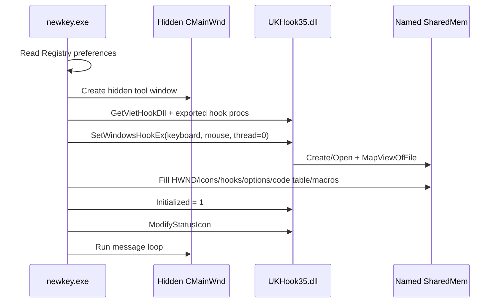
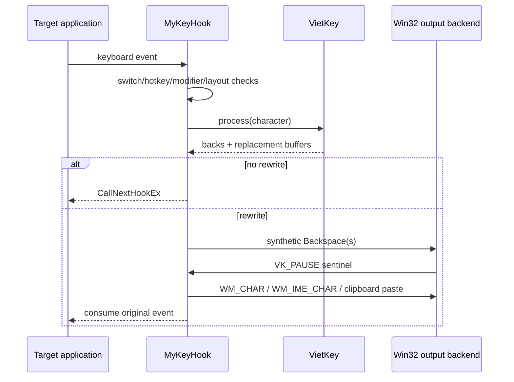

# UniKey baseline — kiến trúc và luồng nghiệp vụ để đối chiếu EVKey

## 1. Phạm vi và cách đọc

- Mã nguồn được phân tích tại commit `e3b8f3b53bdaa700945a62e99129df625509cd38`.
- Trọng tâm: `src-win/keyhook`, `src-win/newkey`, `unikey/keyhook`, `unikey/newkey`, và engine `x-unikey/src/ukengine`.
- Không build hoặc chạy binary. Kết luận dưới đây là phân tích tĩnh từ mã nguồn.
- Khi nói **Windows UniKey**, báo cáo chủ yếu nói tới nhánh đầy đủ hơn trong `unikey/`; `src-win/` được dùng như snapshot tiền nhiệm để nhận diện sự tiến hóa.
- Khi nói **engine độc lập nền tảng**, báo cáo nói tới `x-unikey/src/ukengine` cùng abstraction charset mà nó dùng. Không được đồng nhất engine này với lớp `VietKey` cũ nằm trực tiếp trong Windows hook.

## 2. Kết luận điều hành

UniKey trong snapshot này có **hai thế hệ kiến trúc cùng tồn tại**:

1. **Windows architecture cũ/đang vận hành trong `unikey/`**: một EXE ẩn quản lý UI/tray/config, một hook DLL được Windows nạp vào các process đích, vùng nhớ dùng chung tên cố định làm control plane, và lớp `VietKey` xử lý phím ngay trong DLL. Đây là baseline gần nhất cho cơ chế hook/injection/IPC kiểu EVKey.
2. **Engine mới hơn trong `x-unikey/src/ukengine`**: thư viện xử lý tiếng Việt tách khỏi UI và cơ chế bắt/phát phím. Nó chuẩn hóa phím thành event ngữ nghĩa, duy trì trạng thái cấu trúc từ `C/V/CV/VC/CVC`, kiểm tra chính tả, tự phục hồi keystroke và xuất qua abstraction charset. Đây là baseline tốt hơn cho thuật toán lõi hiện đại.

Điểm kiến trúc quan trọng nhất để đối chiếu EVKey là ranh giới:

```text
Windows integration                              Platform-independent core
-------------------                              -------------------------
WinMain / hidden window / tray                    UkInputProcessor
WH_KEYBOARD + WH_MOUSE hooks                      UkEngine word-state machine
named file mapping / posted messages              Vowel/Consonant sequence tables
keybd_event / WM_CHAR / clipboard-paste           Macro matching
Registry / dialogs / menus                        VnCharset + VnConvert
```

Trong nhánh Windows `unikey/`, ranh giới này chưa sạch: `VietKey` vẫn sống trong hook DLL, gọi Win32 (`GetKeyState`) và đọc trực tiếp `SharedMem` (`unikey/keyhook/vietkey.h:26-68`, `unikey/keyhook/vietkey.cpp:639-650`). Ngược lại, `x-unikey/src/ukengine` chỉ bọc Windows bằng `#if defined(_WIN32)` (`x-unikey/src/ukengine/stdafx.h:8-17`, `x-unikey/src/ukengine/keycons.h:64-77`) và được đóng gói thành library phụ thuộc `vnconv` (`x-unikey/src/ukengine/Makefile.am:1-18`).

## 3. Dòng tiến hóa trong repository

### 3.1 `src-win/`: snapshot Windows cũ

`src-win` là biến thể tối giản hơn:

- README yêu cầu mở workspace `newkey\newkey.dsw` và build cấu hình Win32 (`src-win/readme.txt:6-9`).
- EXE giữ một `SharedMem ShMem` cục bộ rồi sao chép toàn bộ sang DLL qua `InitSharedMem(&ShMem)` (`src-win/newkey/mainwnd.cpp:74-85`, `src-win/newkey/mainwnd.cpp:480-499`).
- Hook DLL vẫn tạo named file mapping `UniKeyHookDllFileMap`; `InitSharedMem` copy control block vào mapping (`src-win/keyhook/keyhook.cpp:74-109`, `src-win/keyhook/keyhook.cpp:160-175`).
- UI chỉ có cấu hình cơ bản, Telex/VNI, bảng mã và tray; menu cũ thể hiện phạm vi này (`src-win/newkey/mainwnd.cpp:34-43`).

### 3.2 `unikey/`: Windows implementation đầy đủ hơn

So với `src-win`, `unikey/` thêm macro editor/table, toolkit chuyển mã, VIQR/VIQR*, clipboard conversion, phím tắt và tùy chọn Unicode/IME. Bằng chứng trực tiếp:

- Bốn input methods được định nghĩa: Telex, VNI, VIQR, VIQR* (`unikey/keyhook/keycons.h:60-65`).
- `CMainWnd` sở hữu config dialog, toolkit dialog và macro table (`unikey/newkey/mainwnd.h:45-64`).
- Hook shared state có macro table/memory và nhiều option hơn (`unikey/keyhook/keyhook.h:42-85`).

### 3.3 `x-unikey/src/ukengine`: thế hệ engine tách nền tảng

Engine mới không dùng `CodeInfo.DT/BD/BK/BW/BT` làm state model chính. Nó có:

- `UkInputProcessor`: biến keycode thành `UkKeyEvent` (`x-unikey/src/ukengine/inputproc.h:43-68`, `x-unikey/src/ukengine/inputproc.h:75-105`).
- `UkEngine`: state machine của từ, backspace/output contract và macro (`x-unikey/src/ukengine/ukengine.h:64-100`, `x-unikey/src/ukengine/ukengine.h:101-162`).
- `UkSharedMem`: cấu hình/input map/charset/macro store không chứa pointer; comment yêu cầu an toàn khi chia sẻ giữa process (`x-unikey/src/ukengine/ukengine.h:31-48`).
- Custom keymap được load từ file dưới dạng `name=value` và ánh xạ label ngữ nghĩa như `Tone1`, `Roof-A`, `Hook-UO`, `D-Mark` (`x-unikey/src/ukengine/usrkeymap.cpp:34-75`, `x-unikey/src/ukengine/usrkeymap.cpp:79-125`).

## 4. Bản đồ component

| Component | Trách nhiệm | Entry/API chính | Phụ thuộc |
|---|---|---|---|
| `unikey/newkey` EXE | hidden main window, tray, dialogs, menu, preference, macro file, toolkit | `WinMain`, `CMainWnd::WindowProc`, `initDLL` | Win32, hook DLL, `vnconv` |
| `unikey/keyhook` DLL | global keyboard/mouse hook, shared state, switch mode, inject output | `DllMain`, `MyKeyHook`, `MyMouseHook`, exports trong `.def` | Win32, `VietKey` |
| `unikey/keyhook/VietKey` | table-driven Vietnamese composition cho Windows hook | `process`, `putToneMark`, `doubleChar`, `putBreveMark`, `checkMacro` | `SharedMem`, Win32 key state |
| `unikey/newkey/encode` | build bảng phân loại phím + bảng mã cho `VietKey` | `BuildCodeTable`, `BuildInputMethod` | static charset maps |
| `unikey/vnconv` | chuyển mã memory/file qua ký tự trung gian chuẩn | `VnConvert`, `VnFileConvert`, `VnCharset` | byte streams; Win32 chỉ ở nhánh I/O |
| `x-unikey/src/ukengine` | state machine tiếng Việt tách host integration | `UkEngine::process`, `processBackspace`, `restoreKeyStrokes` | `vnconv`, `inputproc`, `mactab` |

DLL export contract của Windows được cố định theo ordinal: hook callbacks, mode/tray functions, setters và `GetSharedMem` (`unikey/keyhook/keyhook.def:20-33`). Đây là ABI integration quan trọng nếu EVKey kế thừa hoặc mô phỏng UniKey.

## 5. Entry points và lifecycle Windows

### 5.1 EXE startup

`WinMain` thực hiện tuần tự:

1. Khởi tạo RTF I/O.
2. Tìm hidden main window cũ để bảo đảm single instance; nếu có thì foreground và mở panel (`unikey/newkey/mainwnd.cpp:287-321`).
3. Đọc preference từ Registry (`unikey/newkey/mainwnd.cpp:322-325`).
4. Tạo hidden top-level window; nạp font/menu/help/macro mặc định `ukmacro.txt` (`unikey/newkey/mainwnd.cpp:46-95`).
5. Lấy module hook DLL, cài global keyboard/mouse hook, lấy shared memory và điền control state (`unikey/newkey/mainwnd.cpp:327-404`).
6. Tạo tray icon, tùy cấu hình thì mở panel, sau đó chạy message loop (`unikey/newkey/mainwnd.cpp:331-344`).
7. Khi thoát, unhook keyboard/mouse rồi cleanup (`unikey/newkey/mainwnd.cpp:346-352`).

`InitApplication` đăng ký window class với generic `GenWindowProc`; cửa sổ thực tế được tạo ẩn với `WS_EX_TOOLWINDOW` (`unikey/newkey/mainwnd.cpp:46-63`, `unikey/newkey/mainwnd.cpp:253-283`). Vì vậy UI chính là một message pump/control window, không phải cửa sổ luôn hiển thị.

### 5.2 Hook DLL startup trong từng process

Khi DLL attach:

- `CreateFileMapping(INVALID_HANDLE_VALUE, ..., sizeof(SharedMem), "UniKeyHookSharedMem3.6X Release")` tạo/mở mapping dùng page file (`unikey/keyhook/keyhook.cpp:119-147`).
- `MapViewOfFile` cho mỗi process một view tới cùng control block (`unikey/keyhook/keyhook.cpp:140-149`).
- `InitProcess` gắn `VnKbd` vào `codeTable`, tính scan codes và nạp US/Vietnamese keyboard layouts (`unikey/keyhook/keyhook.cpp:204-217`).
- Chỉ process tạo mapping lần đầu gọi `initDLL`; hàm này đặt trạng thái chưa initialized và ghi thông tin version Windows (`unikey/keyhook/keyhook.cpp:151-152`, `unikey/keyhook/keyhook.cpp:944-955`).

EXE gọi `SetWindowsHookEx(WH_KEYBOARD, ..., HookDll, 0)` và `WH_MOUSE` với thread id `0` (`unikey/newkey/mainwnd.cpp:356-370`). **Suy luận từ Win32 semantics**: DLL được inject/load vào các GUI process nhận hook; named mapping là IPC/control plane chung giữa EXE và các DLL instance.

### 5.3 Shutdown/config persistence

`WM_DESTROY`/`WM_QUERYENDSESSION` snapshot Vietnamese mode rồi ghi preference; `WM_DESTROY` kết thúc message loop (`unikey/newkey/mainwnd.cpp:157-164`). Tray icon bị xóa trước `DestroyWindow` ở lệnh Exit (`unikey/newkey/mainwnd.cpp:199-209`).

## 6. Shared state và IPC

### 6.1 Nội dung control block Windows

`SharedMem` gồm bốn nhóm (`unikey/keyhook/keyhook.h:59-85`):

- **Runtime state**: `Initialized`, `vietKey`, `iconShown`, switch key.
- **Configuration**: keyboard options, charset mode, input method, `CodeInfo`.
- **Win32 integration**: hook handles, main HWND, tray callback, icons, OS version.
- **Macro data**: offset table + flat byte buffer + item count.

Thiết kế offset-based của macro tránh pointer không hợp lệ giữa các address spaces: `HookMacroDef` chỉ lưu `keyOffset`/`textOffset` (`unikey/keyhook/keyhook.h:53-57`), còn dữ liệu nằm trong `macroMem` (`unikey/keyhook/keyhook.h:80-84`).

### 6.2 Hướng truyền dữ liệu

- **EXE → hook DLL instances**: ghi trực tiếp vào file mapping qua `pSharedMem`, hoặc gọi setter exported (`SetKeyMode`, `SetInputMethod`, `SetSwitchKey`) để cập nhật và reset buffer (`unikey/keyhook/keyhook.cpp:777-820`).
- **Hook DLL → EXE**: post/send private `WM_USER` messages cho panel, toolkit, fly-convert và đổi charset (`unikey/keyhook/keyhook.h:106-109`, `unikey/keyhook/keyhook.cpp:831-912`).
- **EXE → application đích**: không trực tiếp; DLL instance trong target process thực hiện backspace/output injection.

`CMainWnd::updateChanges` dùng bitmask để cập nhật đúng phần thay đổi: charset thì rebuild full code table + macro; input method thì chỉ rebuild DT; switch/options có setter riêng (`unikey/newkey/mainwnd.cpp:459-489`). Đây là pattern baseline tốt cho EVKey: UI không nên tự xử lý phím mà chỉ phát cấu hình xuống control plane.

### 6.3 Điểm cần thận trọng khi tái dựng

- Không thấy mutex/version counter quanh `SharedMem`; cập nhật cấu trúc lớn (`codeTable`, macro memory) có thể được process hook đọc đồng thời. Cần xác minh runtime thực tế hoặc assembly trước khi kết luận atomicity.
- `hMapObject` là local variable trong `DllMain`; ở nhánh detach, biến được khởi tạo lại thành `NULL` trước `CloseHandle` (`unikey/keyhook/keyhook.cpp:119-122`, `unikey/keyhook/keyhook.cpp:171-180`). View vẫn được unmap, nhưng lifecycle handle mapping trong source này đáng ngờ.
- Shared state chứa Win32 handles có ý nghĩa cross-process theo kiểu kernel handle/HWND, nhưng icon handles và hook handles cần kiểm chứng trên Windows version đích.

## 7. Luồng bắt và xử lý một phím trên Windows

### 7.1 Hook front-end

`MyKeyHook` là orchestration layer (`unikey/keyhook/keyhook.cpp:220-355`):

1. Bỏ qua khi chưa initialized, hook code âm hoặc foreground là console (`unikey/keyhook/keyhook.cpp:225-234`).
2. Đọc keyboard state/layout; bắt switch key và hotkeys trước (`unikey/keyhook/keyhook.cpp:236-243`).
3. Nếu đang trong pha clipboard paste, hoãn phím mới bằng synthetic event (`unikey/keyhook/keyhook.cpp:245-259`).
4. Xử lý sentinel/backspace pipeline và chặn reentrancy (`unikey/keyhook/keyhook.cpp:261-274`).
5. Nếu Vietnamese hoặc always-macro đang bật, không có Ctrl/Alt conflict, dùng `ToAscii`/`ToAsciiEx` để ra character (`unikey/keyhook/keyhook.cpp:276-301`).
6. Numpad đi thẳng vào buffer; ký tự thường gọi `VnKbd.process(c)` (`unikey/keyhook/keyhook.cpp:301-307`).
7. Nếu engine yêu cầu xóa hoặc phát lại, gọi `PushBacks` rồi consume original event (`unikey/keyhook/keyhook.cpp:307-312`).
8. Phím không phải text/reset condition sẽ clear composition buffer (`unikey/keyhook/keyhook.cpp:322-335`).

Mouse left click cũng reset buffer để không áp dấu vào context caret mới (`unikey/keyhook/keyhook.cpp:713-718`). Ctrl không đi kèm Alt cũng kích hoạt deferred reset, tránh phá AltGr trên layout Pháp/Đức (`unikey/keyhook/keyhook.cpp:658-677`).

### 7.2 Rewrite protocol: backspace rồi phát replacement

`VietKey` trả về hai số liệu:

- `backs`: số keystroke/đơn vị output phải xóa.
- `keysPushed` + `ansiPush`/`uniPush`: chuỗi replacement (`unikey/keyhook/vietkey.h:58-68`).

`PushBacks`:

- Nếu không cần xóa, gọi `PushBuffer` ngay.
- Nếu cần xóa, tạm nhả modifier, phát các cặp `VK_BACK` down/up, rồi phát `VK_PAUSE` key-up làm sentinel (`unikey/keyhook/keyhook.cpp:592-615`).
- `CheckBack` bắt sentinel, kết thúc pha backspace, restore modifier và mới gọi `PushBuffer` (`unikey/keyhook/keyhook.cpp:618-628`).

### 7.3 Các backend phát output

`PushBuffer` chọn đường output theo charset (`unikey/keyhook/keyhook.cpp:384-468`):

- Unicode UCS-2 + target Unicode: `PostMessageW(WM_CHAR/WM_IME_CHAR)` từng code unit (`unikey/keyhook/keyhook.cpp:391-400`).
- Unicode fallback hoặc tùy chọn clipboard: ghi `CF_UNICODETEXT`/`CF_TEXT`, phát paste command, đặt cờ đang paste (`unikey/keyhook/keyhook.cpp:401-427`).
- Decomposed Unicode: gửi Unicode trực tiếp hoặc đổi sang CP1258 + activate Vietnamese layout (`unikey/keyhook/keyhook.cpp:429-452`).
- Charset khác: `PostMessage(WM_CHAR/WM_IME_CHAR)` các byte; riêng CP1258 có thể đổi keyboard layout (`unikey/keyhook/keyhook.cpp:454-466`).

Đây là một điểm baseline quan trọng: **composition algorithm chỉ quyết định backspaces + replacement; host integration quyết định injection transport**. EVKey nên được đối chiếu theo từng transport, không chỉ theo kết quả text.

## 8. State machine `VietKey` của Windows

### 8.1 Trạng thái

`VietKey` giữ buffer tối đa 40 ký tự, case từng ký tự, trạng thái `lastWConverted`, `lastIsEscape`, `tempVietOff`, các bảng mã và output buffers (`unikey/keyhook/vietkey.h:23-68`). Khi đầy, nó giữ lại 20 ký tự cuối (`unikey/keyhook/vietkey.cpp:803-809`).

Đây không phải automaton hình thức theo âm tiết; nó là **buffered rewrite machine** dựa trên bảng bit-packed `DT`:

- bits 0–4: vowel index;
- 5–8: shortcut/macro-key index;
- 9–13: double character;
- 14–17: tone action;
- 18–21: tone hiện tại;
- bit 22: breve;
- bit 24/25: soft/hard separator;
- 26–28: VNI decoration;
- bit 29: word stop (`unikey/keyhook/keycons.h:23-47`).

### 8.2 Dispatch nghiệp vụ

`VietKey::process` reset output counters, phân loại phím bằng `keyCategory`, xử lý always-macro khi Vietnamese off, escape mode, macro-at-word-end, rồi dispatch (`unikey/keyhook/vietkey.cpp:130-241`):

```text
BREVE_MARK            -> putBreveMark
DOUBLE_KEY             -> doubleChar
TONE_MARK              -> putToneMark
SHORT_KEY              -> shortKey
VNI_DOUBLE_CHAR_MARK   -> vniDoubleCharMark
ESCAPE_KEY             -> arm escape
SEPARATOR_KEY          -> backspace handling hoặc clear buffer
```

Nếu action không tạo rewrite, ký tự được append nguyên trạng. Nếu có rewrite, `postProcess` encode chuỗi nội bộ sang charset đích (`unikey/keyhook/vietkey.cpp:242-267`, `unikey/keyhook/vietkey.cpp:306-401`).

### 8.3 Tone placement

`putToneMark`:

- Tìm nguyên âm gần nhất trong giới hạn `MAX_AFTER_VOWEL` (`unikey/keyhook/vietkey.cpp:690-707`).
- Thu thập chuỗi nguyên âm liên tiếp và chọn vị trí theo độ dài, `modernStyle`, special cases `qu`/`gi`, và có/không phụ âm cuối (`unikey/keyhook/vietkey.cpp:709-743`).
- Tra `BD[vowel][tone]`; nếu gõ lặp cùng dấu thì bỏ dấu và phát literal action key, đồng thời bật `tempVietOff` để tránh vòng chuyển tiếp (`unikey/keyhook/vietkey.cpp:745-768`).

### 8.4 Roof/hook/breve/DD và undo

- `doubleChar` tìm mục tiêu có thể nhận circumflex/DD, kiểm tra Telex/VNI và trường hợp `oeo`, rồi rewrite suffix; action lặp lại hoàn nguyên về English và đưa máy vào temporary-off (`unikey/keyhook/vietkey.cpp:555-634`).
- `putBreveMark` xử lý horn/breve, kể cả các chuỗi `uo/uơ/ươ` và free-marking; action lặp lại cũng hoàn nguyên (`unikey/keyhook/vietkey.cpp:447-551`).
- `vniDoubleCharMark` chỉ dispatch các action 6/7/8/9 sang `doubleChar` hoặc `putBreveMark` (`unikey/keyhook/vietkey.cpp:784-800`).
- `shortKey` xử lý Telex shortcuts `[ ] w W { }`, bảo toàn case theo Shift/CapsLock (`unikey/keyhook/vietkey.cpp:639-686`).

## 9. Telex, VNI và VIQR

### 9.1 Windows table builder

Input method không được hard-code hoàn toàn trong engine; `BuildInputMethod` dựng `DT` (`unikey/newkey/encode.cpp:493-502`).

- **Telex**: `s/f/r/x/j/z` cho tone, `w/W` cho breve/horn, `aa/ee/oo/dd` qua double-char index, `[ ] w W { }` là shortcut (`unikey/newkey/encode.cpp:453-460`, `unikey/newkey/encode.cpp:504-565`).
- **VNI**: `1..5/0` tone, `6..9` decoration (`unikey/newkey/encode.cpp:481-483`, `unikey/newkey/encode.cpp:618-635`).
- **VIQR**: `' ` ? ~ . 0` tone; `^ + ( d` decoration. VIQR* đổi horn từ `+` thành `*` (`unikey/newkey/encode.cpp:475-489`, `unikey/newkey/encode.cpp:620-635`).
- Backslash được xem là escape trong VIQR/VIQR* (`unikey/keyhook/vietkey.cpp:415-443`).

`BuildCodeTable` tách hai chiều: map nội bộ composition và map output charset; VIQR được tạo như chuỗi base + decoration/tone (`unikey/newkey/encode.cpp:639-679`).

### 9.2 Engine mới: key → semantic event

`x-unikey` biến mỗi phương thức thành bảng `key → UkKeyEvName`:

- Telex (`x-unikey/src/ukengine/inputproc.cpp:100-117`).
- Simple Telex (`x-unikey/src/ukengine/inputproc.cpp:119-132`).
- VNI (`x-unikey/src/ukengine/inputproc.cpp:134-146`).
- VIQR, bao gồm escape `\` (`x-unikey/src/ukengine/inputproc.cpp:148-162`).
- Microsoft Vietnamese và user-defined mapping cũng được hỗ trợ (`x-unikey/src/ukengine/inputproc.cpp:164-190`, `x-unikey/src/ukengine/inputproc.cpp:283-290`).

`keyCodeToEvent` gắn đồng thời event action, character type, Vietnamese lexical symbol và tone; direct-character mappings dùng action >= `vneCount` rồi chuẩn hóa thành `vneMapChar` (`x-unikey/src/ukengine/inputproc.cpp:319-345`).

## 10. State machine của `x-unikey/src/ukengine`

### 10.1 Mô hình trạng thái từ

Mỗi vị trí buffer giữ:

- form của prefix kết thúc ở vị trí đó: `nonVn`, `empty`, `c`, `v`, `cv`, `vc`, `cvc`;
- offsets tới cụm phụ âm đầu/nguyên âm/phụ âm cuối;
- vowel/consonant sequence ID;
- caps, tone, canonical lexical symbol và original keycode (`x-unikey/src/ukengine/ukengine.h:127-145`).

Bảng `VSeqList` mã hóa độ dài, tính hoàn chỉnh, khả năng nhận phụ âm cuối, biến thể roof/hook và vị trí biến đổi (`x-unikey/src/ukengine/ukengine.cpp:68-94`). `CSeqList` và `VCPairList` mã hóa phụ âm hợp lệ và quan hệ vowel-suffix (`x-unikey/src/ukengine/ukengine.cpp:155-206`, `x-unikey/src/ukengine/ukengine.cpp:208-264`). Các bảng được sort để lookup bằng `bsearch` (`x-unikey/src/ukengine/ukengine.cpp:428-489`).

### 10.2 Dispatch

`UkKeyProcList` ánh xạ event ngữ nghĩa tới handler roof/hook/DD/tone/Telex-W/map/escape/append (`x-unikey/src/ukengine/ukengine.cpp:268-291`). `UkEngine::process`:

1. Chuẩn bị buffer và reset session output fields.
2. `keyCodeToEvent`.
3. Dispatch qua member-function table, trừ khi escape đang armed.
4. Nếu spell-check fail nhưng chế độ cho phép, coi ký tự mới là đầu từ mới.
5. Ghi lại raw keystroke cùng cờ `converted`.
6. Trả contract `(ret, backs, outBuf, outSize, outType)` (`x-unikey/src/ukengine/ukengine.cpp:1734-1808`).

### 10.3 Chuyển trạng thái append

`processAppend` tách reset, word-break, non-Vietnamese và Vietnamese; ký tự vowel đi `appendVowel`, còn lại đi `appendConsonnant` (`x-unikey/src/ukengine/ukengine.cpp:1293-1344`).

`appendVowel` chuyển theo form trước đó:

- empty → `v`;
- invalid/nonVn/VC/CVC + vowel → `nonVn`;
- V/CV + vowel → lookup chuỗi nguyên âm mới, validate prefix, reposition tone;
- C + vowel → `cv` nếu `isValidCV` (`x-unikey/src/ukengine/ukengine.cpp:1347-1501`).

`appendConsonnant` xây `c`, `vc`, `cvc`, validate onset-vowel-coda, xử lý đặc biệt `uơ/ươ`, và reposition tone khi thêm coda (`x-unikey/src/ukengine/ukengine.cpp:1505-1684`).

### 10.4 Dấu và decoration

- `processRoof`, `processHook`, `processTone`, `processDd` chỉ transform khi target/word context hợp lệ; nếu không thì fallback `processAppend` (`x-unikey/src/ukengine/ukengine.cpp:492-550`, `x-unikey/src/ukengine/ukengine.cpp:789-899`, `x-unikey/src/ukengine/ukengine.cpp:961-1017`, `x-unikey/src/ukengine/ukengine.cpp:1022-1075`).
- Tone placement dùng metadata vowel sequence và option modern style (`x-unikey/src/ukengine/ukengine.cpp:936-959`).
- `markChange` tính số backspace theo charset chứ không giả định một byte bằng một ký tự (`x-unikey/src/ukengine/ukengine.cpp:1852-1899`).
- `writeOutput` chuyển canonical symbol + caps + tone sang `StdVnChar`, rồi giao cho `VnCharset::putChar` (`x-unikey/src/ukengine/ukengine.cpp:1818-1846`).

### 10.5 Word-end, spell checking và auto-restore

Ở word break:

1. Macro được thử trước.
2. Nếu spell-check tắt/single mode thì commit separator.
3. Nếu word không phải tiếng Việt và `autoNonVnRestore` bật, engine thay chuỗi đã biến đổi bằng raw keystrokes.
4. Sau đó append separator (`x-unikey/src/ukengine/ukengine.cpp:2270-2316`).

`lastWordIsNonVn` kiểm tra form, vowel completeness, CVC validity và giới hạn tone với coda `c/ch/p/t` (`x-unikey/src/ukengine/ukengine.cpp:2322-2360`). `restoreKeyStrokes` chỉ chạy nếu word thực sự có Vietnamese marks và có key đã converted; output type chuyển thành `UkKeyOutput` (`x-unikey/src/ukengine/ukengine.cpp:2183-2233`).

Đây là khác biệt lớn với `VietKey` cũ: engine mới có **raw keystroke history + linguistic validity**, không chỉ character rewrite history.

## 11. Macro

### 11.1 Windows implementation

- File mặc định `ukmacro.txt` nằm cạnh EXE và được load khi main window khởi tạo (`unikey/newkey/mainwnd.cpp:80-95`).
- Format cũ là từng dòng `key:text`; bảng giữ sorted entries trong flat memory (`unikey/newkey/mactab.cpp:43-58`, `unikey/newkey/mactab.cpp:136-153`).
- Khi cấu hình/charset thay đổi, EXE copy key và replacement đã convert sang output charset vào shared memory; macro table lưu offsets (`unikey/newkey/mainwnd.cpp:530-572`).
- `VietKey::checkMacro` chạy tại word stop/Enter, Shift+Space vô hiệu expansion, dùng `bsearch`, tính số backspace và phát replacement + delimiter (`unikey/keyhook/vietkey.cpp:967-1017`, `unikey/keyhook/vietkey.cpp:1018-1039`).
- Macro có thể bật cả khi Vietnamese mode tắt qua `alwaysMacro` (`unikey/keyhook/vietkey.cpp:146-161`).

Macro dialog tạm đổi hook sang VIQR/Unicode để người dùng nhập nội dung, tắt macro recursion, rồi phục hồi mode hệ thống (`unikey/newkey/macrodlg.cpp:355-385`). Nó hỗ trợ chọn macro file hoặc file mặc định (`unikey/newkey/macrodlg.cpp:390-478`).

### 11.2 Engine mới

`CMacroTable` mới chứa arrays cố định, không pointer, phù hợp shared memory (`x-unikey/src/ukengine/mactab.h:42-75`). Nó:

- đọc header version, hỗ trợ UTF-8 và migrate format VIQR cũ (`x-unikey/src/ukengine/mactab.cpp:114-165`, `x-unikey/src/ukengine/mactab.cpp:167-207`);
- sort/lookup case-insensitive trên `StdVnChar` (`x-unikey/src/ukengine/mactab.cpp:43-112`);
- trong expansion, suy ra case của key và biến đổi replacement tương ứng, rồi `VnConvert` sang charset đích (`x-unikey/src/ukengine/ukengine.cpp:2049-2157`).

## 12. Charset conversion

### 12.1 Separation of concerns

Có hai lớp dễ nhầm:

- `unikey/newkey/encode.cpp` dựng bảng output phục vụ realtime keystroke rewrite.
- `unikey/vnconv` là converter tổng quát memory/file, dùng intermediate `StdVnChar`.

`VnConvert` resolve input/output charset objects, wrap byte streams rồi gọi `genConvert` (`unikey/vnconv/convert.cpp:37-60`, `unikey/vnconv/convert.cpp:77-96`). `genConvert` đọc từng ký tự chuẩn, tùy chọn lower/upper/remove-tone, rồi phát qua output charset (`unikey/vnconv/convert.cpp:37-60`).

`VnCharset` là interface `nextInput`/`putChar`; concrete classes bao phủ single-byte, double-byte, Unicode, UTF-8, numeric refs, C-string, CP1258, decomposed Unicode, VIQR và UTF8-VIQR (`unikey/vnconv/charset.h:66-127`, `unikey/vnconv/charset.h:148-224`).

### 12.2 Toolkit flow

Toolkit UI:

1. Lấy input/output charset và chọn clipboard hay file.
2. Với clipboard, gọi `ConvertClipboard`.
3. Với file, set conversion options, chọn RTF converter hoặc `VnFileConvert`, rồi restore global options (`unikey/newkey/tooldlg.cpp:385-461`).
4. RTF path giữ formatting qua converter riêng; clipboard path đăng ký `Rich Text Format` (`unikey/newkey/tooldlg.cpp:530-577`).

Fly-convert được kích từ menu hoặc Ctrl+Shift+F9 message của hook (`unikey/newkey/mainwnd.cpp:173-180`, `unikey/keyhook/keyhook.cpp:899-909`).

## 13. Config persistence

`CUserPref` là model chung cho UI + hook options. Các trường persisted gồm mode, charset, switch key, input method, free marking, tone style, modern style, UI language, converter charsets, macro flags, Unicode clipboard và IME (`unikey/newkey/userpref.h:37-67`).

- Registry path: `HKCU\Software\PkLong\UniKey` (`unikey/newkey/userpref.cpp:23-24`).
- `setValue` ghi các `REG_DWORD`, sau đó đồng bộ autostart (`unikey/newkey/userpref.cpp:65-103`).
- `getValue` đọc toàn bộ; nếu thiếu/bất kỳ lỗi nào thì reset default, rồi validate ranges (`unikey/newkey/userpref.cpp:106-193`).
- Defaults: Telex, charset index 0, Vietnamese off, macro off, clipboard conversion on (`unikey/newkey/userpref.cpp:29-63`).
- Autostart dùng `Software\Microsoft\Windows\CurrentVersion\Run`, HKCU trên NT và HKLM trên non-NT (`unikey/newkey/userpref.cpp:198-246`).

Một đặc điểm đáng đối chiếu: đọc config dùng chiến lược **all-or-default** — một value lỗi làm reset toàn bộ (`unikey/newkey/userpref.cpp:171-173`), không phải migration từng field.

## 14. UI, menu và tray

### 14.1 Main window và tray

- Main window ẩn, chỉ dùng làm owner/message endpoint (`unikey/newkey/mainwnd.cpp:46-63`).
- Tray click trái toggle Vietnamese; click phải mở popup; double-click toggle rồi chạy default menu command (`unikey/newkey/mainwnd.cpp:128-155`).
- `ModifyStatusIcon` đổi icon + tooltip theo `vietKey`; `DeleteStatusIcon` xóa icon (`unikey/keyhook/keyhook.cpp:721-768`).
- Sau Explorer restart, message `TaskbarCreated` dựng lại icon (`unikey/newkey/mainwnd.cpp:112-115`, `unikey/newkey/mainwnd.cpp:241-246`).

### 14.2 Menu/config/toolkit

- Popup menu thay đổi trực tiếp charset/input method qua preference change flags (`unikey/newkey/ukmenu.cpp:99-159`).
- Config panel và toolkit là modeless dialogs do `CMainWnd` sở hữu (`unikey/newkey/mainwnd.cpp:491-515`).
- Config dialog copy preference sang temporary model, đánh dấu bitmask theo field thay đổi, rồi owner áp dụng (`unikey/newkey/keydlg.cpp:232-287`, `unikey/newkey/mainwnd.cpp:227-238`).
- Hotkeys hook→UI: Ctrl+Shift+F5 panel, F6 toolkit, F1–F4 charset, F9 fly-convert (`unikey/keyhook/keyhook.cpp:845-909`).

## 15. Sequence diagrams

### 15.1 Startup



### 15.2 Key rewrite



### 15.3 Platform-independent engine contract

```mermaid
flowchart LR
    K[Host keycode] --> IP[UkInputProcessor]
    IP --> E[UkKeyEvent]
    E --> D[UkKeyProcList dispatch]
    D --> S[WordInfo state C/V/CV/VC/CVC]
    S --> V[Spell/sequence validation]
    V --> M[markChange: backs + changePos]
    M --> C[VnCharset output]
    C --> R[ret, backs, bytes, UkOutputType]
    R --> H[Host-specific injector]
```



## 16. Baseline đối chiếu EVKey

| Trục so sánh | UniKey baseline | Câu hỏi cần trả lời ở EVKey |
|---|---|---|
| Process model | EXE hidden window + globally injected hook DLL | EVKey còn inject DLL hay dùng low-level hook/TSF/IME/service? |
| Shared control | named file mapping chứa cấu hình, handles, macro data | Mapping name/schema/versioning/synchronization của EVKey là gì? |
| Hook type | `WH_KEYBOARD` + `WH_MOUSE`, thread id 0 | Hook scope, bitness bridge và console/UWP handling khác thế nào? |
| Engine location | Windows `VietKey` chạy trong injected DLL | EVKey xử lý trong target, broker process hay IPC về main process? |
| Engine contract | backs + replacement buffers | EVKey biểu diễn edit transaction và caret/context ra sao? |
| Output transport | `WM_CHAR`, `WM_IME_CHAR`, synthetic backspace, clipboard paste | EVKey chọn `SendInput`, message injection, clipboard hay TSF theo app như thế nào? |
| Composition state | 40-char rewrite buffer; newer engine có WordInfo + raw key history | EVKey dùng state model cũ, ukengine mới, hay fork riêng? |
| Telex/VNI/VIQR | table-driven action mapping | Mapping có giữ semantic actions và custom map không? |
| Spell check | chỉ rõ trong `x-unikey` với C/V/CVC validity | EVKey thêm dictionary/app-specific bypass/restore logic nào? |
| Macro | sorted flat table, expand tại word break, case adaptation ở engine mới | Persistence, Unicode normalization, trigger boundary và security của EVKey? |
| Charset | realtime output maps + generic `VnConvert` library | EVKey còn legacy charset/RTF/CP1258 hay chỉ Unicode? |
| Config | HKCU, all-or-default, change flags | EVKey dùng Registry/INI/JSON; migration và live reload ra sao? |
| UI/tray | hidden owner window, tray callback, modeless panels | Message routing và ownership có tương đồng không? |

## 17. Các invariants nghiệp vụ nên dùng làm test oracle

1. Gõ action không hợp lệ phải đi qua như literal, không mất phím.
2. Gõ lặp cùng action thường hoàn nguyên dấu/decoration và giữ action key literal.
3. Tone phải di chuyển khi thêm/bớt nguyên âm hoặc phụ âm cuối.
4. `qu` và `gi` được xử lý như onset đặc biệt, không phải vowel sequence bình thường.
5. Ctrl/Alt/AltGr, mouse click và non-text key phải reset hoặc bypass composition đúng lúc.
6. Mỗi charset có đơn vị backspace khác nhau; không giả định byte count bằng glyph count.
7. Macro chạy ở word boundary; Shift+Space/Enter có thể vô hiệu expansion.
8. Macro `alwaysMacro` hoạt động khi Vietnamese off.
9. VIQR cần escape cho literal punctuation trùng tone/decorator.
10. Auto-restore chỉ phục hồi raw keys khi word có Vietnamese mark và đã có conversion.
11. Tray state, persisted Vietnamese state và shared `vietKey` phải hội tụ sau toggle/exit/restart.
12. Đổi charset/input method phải reset composition buffer để không trộn hai mapping.

Các invariants 1–6 thể hiện trực tiếp trong fallback `processAppend`, duplicate undo, tone reposition, special cases và charset-aware `markChange` (`x-unikey/src/ukengine/ukengine.cpp:492-550`, `x-unikey/src/ukengine/ukengine.cpp:961-1017`, `x-unikey/src/ukengine/ukengine.cpp:1852-1899`). Invariants 7–10 nằm trong macro/word-end restore (`x-unikey/src/ukengine/ukengine.cpp:2049-2057`, `x-unikey/src/ukengine/ukengine.cpp:2183-2233`, `x-unikey/src/ukengine/ukengine.cpp:2275-2316`).

## 18. Điểm chưa rõ và giới hạn của baseline

1. **Nhánh Windows và `x-unikey` không nối với nhau trong scope đã đọc.** Windows `unikey/keyhook` vẫn instantiate `VietKey`; không có bằng chứng nó dùng `UkEngine`. Vì vậy không được áp kiến trúc `x-unikey` lên binary Windows này nếu chưa kiểm tra project/link map hoặc phiên bản khác.
2. **Không xác minh runtime injection/output compatibility.** `PostMessage(WM_CHAR)`, clipboard paste và keyboard-layout switching phụ thuộc Windows/app/version; source chỉ cho thấy ý đồ.
3. **Không có synchronization rõ ràng cho shared mapping.** Cần dynamic tracing để biết race có xảy ra khi đổi charset/macro trong lúc hook xử lý phím.
4. **Source cũ có nhiều nhánh compile-time ANSI/Unicode và code commented-out.** Báo cáo mô tả đường active theo source, nhưng project configuration cụ thể có thể chọn `_UNICODE`, RTF hoặc unicows khác nhau.
5. **`macro.cpp` của `x-unikey` có `static CMacroTable UkMacroStore`, trong khi `UkEngine` đọc `m_pCtrl->macStore`; wrapper 34 dòng không đủ để chứng minh store toàn cục được dùng trong integration hiện tại** (`x-unikey/src/ukengine/macro.cpp:27-33`, `x-unikey/src/ukengine/ukengine.h:31-48`).
6. **`src-win` là snapshot tiền nhiệm, không phải module chạy đồng thời.** Nó hữu ích để thấy đổi từ `InitSharedMem(copy)` sang `GetSharedMem()` + ghi trực tiếp, nhưng project selection cuối cùng cần xác minh từ solution/build artifacts.
7. Không build/chạy theo ràng buộc nhiệm vụ; do đó ABI, symbol export thực tế, bitness và hành vi trên Windows chưa được xác nhận động.

## 19. Kết luận cho reconstruction EVKey

Baseline hợp lý nhất là tách EVKey thành ba lớp khi đối chiếu:

1. **Host integration**: hook lifecycle, target detection, modifier/layout, backspace/replacement transport, clipboard, tray messages.
2. **Shared control/config**: process boundary, schema, synchronization, persistence, macro distribution.
3. **Pure engine**: key mapping → semantic action → word-state transition → edit transaction → charset encoding.

Nếu EVKey fork từ UniKey, dấu vết dễ nhận nhất không phải tên class mà là các invariants: `backs + replacement`, sentinel chống reentrancy, `qu/gi`, tone reposition, duplicate-to-English undo, always-macro, VIQR escape, và raw-keystroke restore. Đối chiếu theo các invariants này sẽ đáng tin cậy hơn đối chiếu theo UI hoặc tên file.